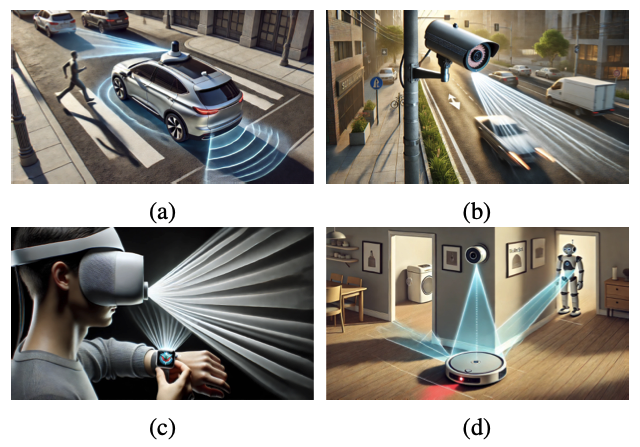

<div align="center">

# Out-of-Sight Embodied Agents: Multimodal Tracking, Sensor Fusion, and Trajectory Forecasting

## Out-of-Sight Trajectory

### TPAMI (Extended Version)

by [Haichao Zhang](https://Hai-chao-Zhang.github.io/), [Yi Xu](https://sites.google.com/view/homepage-of-yi-xu/), [Yun Fu](http://www1.ece.neu.edu/~yunfu/).  
</div>

---

**Pytorch implementation of the TPAMI extended version of ["OOSTraj: Out-of-Sight Trajectory Prediction With Vision-Positioning Denoising"](https://arxiv.org/abs/2404.02227).**

<div align="center">

<a href="">

</a>
</div>

---

Out-of-sight trajectory prediction is critical for real-world applications in autonomous driving, robotics, and surveillance, where agents may become occluded or move beyond the field of view. While previous methods rely on clean visual data, they fail to address challenges from noisy or partial sensor observations.

Our **TPAMI** extension builds upon the CVPR 2024 conference version and presents several key improvements:
- **Generalized prediction for diverse agent types**, including both pedestrians and vehicles.
- A **refined Vision-Positioning Denoising (VPD) framework** with improved feature fusion and uncertainty-aware projection.
- **Expanded benchmarks** on occluded trajectory prediction with comparisons to Kalman/Particle filters and deep learning models.
- **In-depth ablations** and a newly added discussion on limitations and future directions (e.g., dynamic cameras, 3D scene reconstruction).

By robustly denoising trajectories from noisy sensor data and mapping them into coherent visual space, our method significantly boosts performance under out-of-view scenarios. This work sets a new standard for out-of-sight trajectory reasoning.


## 🔧 Datasets

### Processed Vi-Fi and JRDB Datasets  
- [Hugging Face — Out-of-Sight Trajectory Prediction](https://huggingface.co/datasets/haichaozhang/out-of-sight-trajectory-prediction)
- [Google Drive (Original Download)](https://drive.google.com/drive/folders/1W6ze1z8X54kK9BOgYbXYQj_AScf79Z-q?usp=sharing)

The Hugging Face mirror includes both preprocessed `.pkl` files, download instructions, and SHA-256 checksums.

Place the downloaded files into:

```text
OST/
├── vifi_dataset_gps/
│   └── vifi_data.pkl
└── JRDB/
    └── jrdb.pkl
```

These defaults are resolved relative to the repository. Alternatively, leave the
files where they are and pass `--data_file /path/to/the/dataset.pkl`. A relative
`--data_file` is resolved from your working directory. The preprocessed workflow
does not need the original `datasets/RAN4model/` directory or `--is_proc_data`.

### About the missing H3D loader

The public release includes the Vi-Fi and JRDB loaders. `h3d` was a separate
dataset branch whose loader is not included in this repository. It is not a
dependency of Vi-Fi or JRDB. The unconditional H3D import has been removed, and
`--dataset` accepts only `vifi` and `jrdb`; no empty `h3d/` directory is needed.

## Training and evaluation

Use a CUDA-enabled machine with the dependencies in `requirements.txt`. The
original dependency versions target an older environment (Python 3.10 and
PyTorch 1.13); the training/evaluation runner uses CUDA and does not provide a
CPU or Apple MPS execution mode. Run the following commands from the repository
root after installing the dependencies:

```bash
python -m pip install -r requirements.txt

# Train with the downloaded preprocessed data.
python train.py train --dataset vifi --gpus 0
python train.py train --dataset jrdb --gpus 0

# Evaluate each dataset's trained phase-2 weights.
python train.py test --dataset vifi --gpus 0
python train.py test --dataset jrdb --gpus 0
```

Keep the default `--mask_ratio 0.5`: the released model's reshapes assume a
200-frame sequence with a 100-frame observation window. Training settings such
as `--epochs` and `--learning_rate` can be provided explicitly; `--epochs`
applies to each phase separately.

### Where does `phase_2_model.pth` come from?

It is a **trained model state dictionary**, not a dataset or source-code file.
This repository does not bundle pretrained `.pth` weights. With the default
`--phase 1`, `train.py train` runs phase 1 followed by phase 2 and saves the best
validation-loss weights within each phase:

```text
checkpoints/
├── vifi/VisionPosition__Transformer/
│   ├── phase_1_model.pth
│   ├── phase_2_model.pth
│   └── output.log
└── jrdb/VisionPosition__Transformer/
    ├── phase_1_model.pth
    ├── phase_2_model.pth
    └── output.log
vis/
```

The double underscore in `VisionPosition__Transformer` is intentional: the
optional position label is empty by default. Checkpoint directories and `vis/`
are created automatically. Dataset-specific directories prevent Vi-Fi and JRDB
weights from overwriting each other; their model architectures differ.

The current phase-2 loop continues from the final in-memory phase-1 weights and
starts a fresh optimizer/scheduler. It does not reload the best phase-1 file.
`--phase 2` on its own starts a new model; it is **not** a resume command.
`--resume_training` is not implemented and is rejected explicitly. Checkpoints
contain model weights only, not optimizer/scheduler state.

If you already have a compatible checkpoint, you can evaluate without training.
For weights stored elsewhere, including the old non-dataset-specific directory:

```bash
python train.py test --dataset vifi --gpus 0 \
  --data_file /path/to/vifi_data.pkl \
  --checkpoint /path/to/phase_2_model.pth
```

Use `--checkpoint_dir /path/to/run` on both training and testing to override the
default run directory. New checkpoints are portable between single-GPU and
`DataParallel` runs; loading also accepts the `module.` prefix in older
`DataParallel` state dictionaries. Always use weights trained for the selected
dataset and matching model settings.

Without a compatible checkpoint, train first. Generating a new checkpoint does
not by itself establish reproduction of the paper's reported metrics. This
setup repair preserves the existing model, losses, and dataset split logic.

## Local regression checks

```bash
python -m unittest discover -s tests -v
```

These checks cover data-path configuration, checkpoint handling, and both
loaders/models with small synthetic CPU inputs; they do not replace a complete
CUDA training/evaluation run.

## Citation

```bibtex
@article{zhang2026out,
  title={Out-of-Sight Embodied Agents: Multimodal Tracking, Sensor Fusion, and Trajectory Forecasting},
  author={Zhang, Haichao and Xu, Yi and Fu, Yun},
  journal={IEEE Transactions on Pattern Analysis and Machine Intelligence},
  year={2026},
  publisher={IEEE}
}
```
